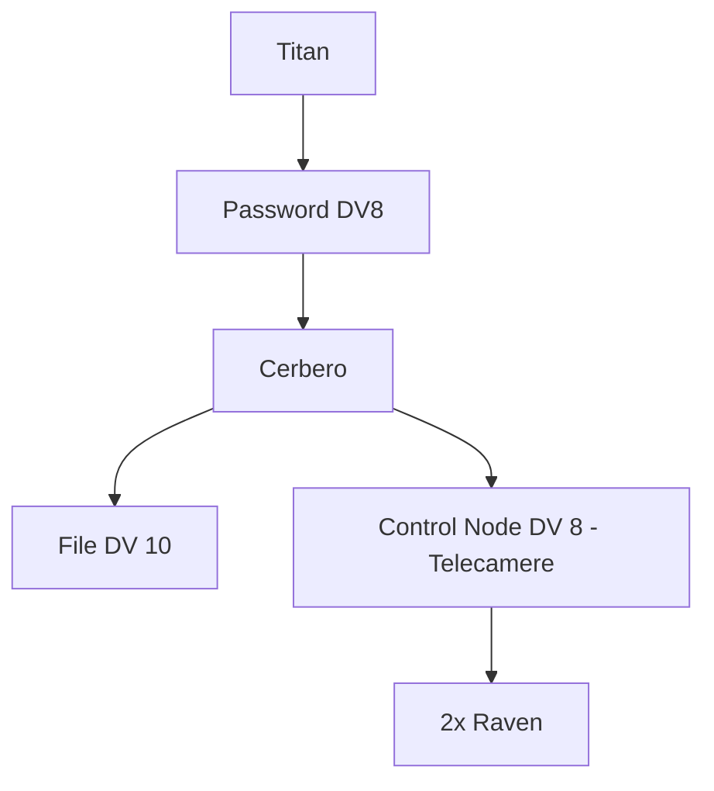

### Pettegolezzi
- Passivo, DV9: Militech ha ri-aperto una sala server a [[Rancho Coronado]] dopo un periodo di inattività. L'acqua a Rancho Coronado a ri-preso ad essere scarsa.

### Premessa
La crew ha intenzione di incontrarsi con [[Amado Villanueva]], avendo ricevuto informazioni riguardo le sue routine. L'intenzione è di trovarlo quando, il lunedì sera del 7 maggio 2046, quest'ultimo si recherà al [[MindNutz Lover]]. 

### Scena 1 - Il MindNutz Lover
Il MindNutz Lover si trova a [[South Night City]], in un quartiere caratterizzato da pochi e sparsi edifici residenziali ancora funzionanti, poche e timide attività commerciali ancora aperte e un sacco di edifici in rovina ormai abbandonati o popolati da senzatetto.
L'odore caratterizzante del quartiere è un mix di lamiera arrugginita e di polvere da sparo, ormai rimasti impregnati nelle pareti e nel cemento della zona. 
In lontananza si sentono rumori di gomme che stridono sull'asfalto, probabilmente derivanti da un inseguimento e, da qualche parte, qualcuno che ascolta un sermone dei [[Reckoners]]. 
A questo si aggiunge la musica proveniente dall'interno del MindNutz Lover, una delle poche attività illuminate a giorno nei dintorni.

![[mindnutz_lover_banner.png|300]]

Amado arriva al MindNutz Lover alle 21, da solo. 
Entrato, si dirigerà direttamente verso il bancone, dove dopo un veloce scambio di parole ritira una chiave. Dopodiché, senza perdere ulteriore tempo, si dirige verso il privé numero 4. Usando la chiave che ha ritirato al bancone, apre la porta, per poi chiudersi dentro.

L'architettura di rete del locale si presenta così:

La pianta del locale, invece, è questa:
![[mindnutz_lover.png]]

### Scena 2 - South Night City
Dopo un breve periodo, Amado esce dalla finestra del bagno del privé, cambiatosi di abito, congiungendosi con due membri del [[Consortium]] che, coperti accuratamente i tatuaggi, si fanno passare per membri dei [[Thelas]].

Fatto ciò, si aggireranno per la zona, dirigendosi verso la [[South Night City Volunteer Fire Station]], senza però puntare direttamente alla struttura. Piuttosto, sembreranno cercare membri degli [[Zoners]]. Una volta trovata una cellula, cominceranno a porsi in maniera ostile nei loro confronti, chiedendo pedaggi, cominciando a bullizzarli per "l'assalto al furgone" ed eventualmente minacciandoli con armi varie. 

![[Consortium goon - SB]]